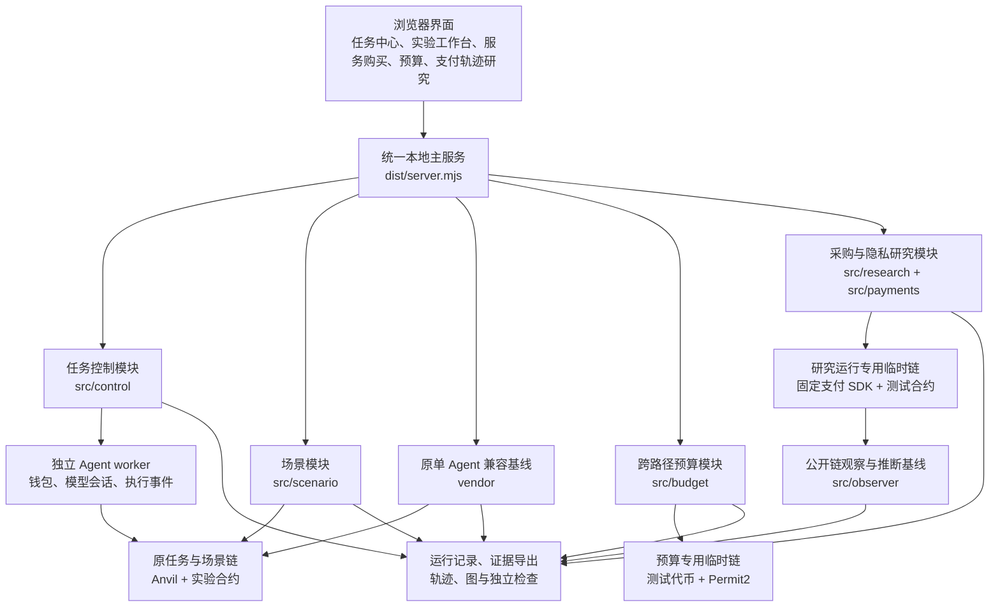

# Web3 Agent Lab

**面向 Web3 Agent 行为、协作、授权与资产效果研究的本地实验平台。**

当前版本：**V0.17.0 Research Beta**（package：`0.17.0-beta.1`）

[V0.17.0 发布页](https://github.com/ZhanHaowen/Web3-Agent-Lab/releases/tag/V0.17.0) · [本版更新说明](docs/V0.17.0-RELEASE-NOTES.md) · [采购与支付轨迹研究指南](docs/V0.17.0-RESEARCH-GUIDE.md) · [本版测试报告](docs/V0.17.0-TEST-REPORT.md) · [本地模型操作指南](docs/V0.16.0本地模型与双后端操作指南.md) · [原操作指南](docs/操作手册.md)

V0.17.0 在原有平台上增加采购与支付轨迹研究模块，支持实际付费工具选择、公开链上观察与私有真值分离，以及任务、总授权预算和采购策略标签的推断评估。新增模块通过独立入口和临时链运行，保留原单 Agent、多 Agent、服务购买、跨路径预算和本地/API 双后端功能。已执行 Windows 回归范围内未发现原核心功能退化；旧数据库迁移、Mac 真机与所有真实模型组合并未全面验证。

V0.16.0 引入的受管本地推理后端继续保留。单 Agent、双 Agent、服务购买及独立 worker 的模型配置可选择 API 或本地 Qwen3 4B；双方可采用不同后端。这里的 Qwen3 是 Agent 使用的语言模型，Agent 的编排、钱包和工具仍由平台提供。

本地推理使用固定 Qwen3-4B-Instruct-2507 Q8_0 GGUF（4,280,404,960 字节），由 llama.cpp 执行；权重单独导入或显式下载，不进入 Git。准备好文件后，本地 Anvil 和本地模型实验无需云端 Key。平台不自动下载、不静默转用云端。Windows x64 的本次实测范围见回归报告；macOS 保留原生启动适配，尚不宣称本次完成真机验收。

模型请求与响应的原始 HTTP 正文、解析结果、失败响应、成本、模型与运行时 SHA、实际模板和运行日志进入实验包。已知凭据脱敏会明确标记，无法取得的指标记为未知；图与检查结论继续作为派生数据保存。

## 平台介绍

Web3 Agent Lab 将模型调用、工具操作、钱包签名、合约执行、资产变化和任务检查放在同一套可观察的实验流程中，帮助研究者分析：Agent 接收了什么任务、依据什么信息采取行动、调用了哪些工具，以及最终产生了什么链上效果。

平台使用本地 Anvil 执行真实 EVM 字节码和交易，通过测试代币、兑换池、Vault、原子换币合约、服务托管合约与 Permit2 构造研究场景。研究者可以通过浏览器配置实验、干预输入与工具返回、暂停执行、查看链上状态，并导出包含原始记录和检查结果的实验包。

平台从单 Agent 任务实验扩展到双 Agent 协商交易、分角色服务购买和跨路径预算控制。不同模块共同服务于以下研究方向：

- **任务执行与模型行为**：比较脚本基线和模型执行，观察模型、提示词、任务参数与工具信息对行动的影响。
- **多 Agent 协作与交易**：观察不同经济主体如何报价、接受、交付、结算，以及各自目标是否实现。
- **权限与资产授权**：分析工具权限、钱包签名和任务预算之间的关系，检查多条操作路径组合后的资产效果。
- **实验记录与独立复查**：将模型、工具、交易与链上证据关联起来，支持结果检查、轨迹回放和离线分析。

脚本基线用于建立实验对照；真实模型模式用于采集模型在相同任务条件下的实际行为。模型接口、执行方式和验收范围按模块分别说明。

## 核心功能

### V0.17.0 采购与支付轨迹研究

本版单独增加四项能力：

1. **可观察支付轨迹**：实际执行本地 HTTP 付费工具请求及 EVM 交易，从公开 RPC 独立采集区块、交易、calldata、回执和日志，导出公开 JSON、GraphML、节点/关系 CSV；研究者原始记录、私有真值和私有溯源图另外保存。
2. **任务推断评估**：三类构造任务共享同一组六个服务和价格规则，采集任务真实答案与结果；使用公开特征进行分类、未知类拒识与分组评估。已具备评估流程，不代表已证明任务可以稳定识别。
3. **隐藏预算推断评估**：总授权预算与钱包余额分别配置，按已结算、预留和确认退款维护私有账本；估计总授权预算并报告 MAE、校准区间和常量基线。当前尚未实现剩余预算时间序列或子 Agent 预算分配推断。
4. **采购策略推断评估**：成本优先、质量优先、根据实际反馈升级三种采购策略；支持规则基线和真实模型决策，比较可观察轨迹对策略标签的区分能力。LLM 的策略标签表示指定策略，尚无独立的策略遵循判别器。

可运行六种本地支付部署：`x402-exact`、`x402-batch`、`ap2-x402-exact`、`ap2-x402-batch`、`mpp-evm-charge`、`erc8183-core`。x402/MPP 使用固定官方 SDK；AP2 是本地签名 mandate 子集；ERC-8183 是本地核心任务托管，不代表完整 AP2 生态或 Virtuals SDK 认证。其余协议仅保留能力清单，不能据名称认定已兼容。

攻击子进程只接收许可的训练/验证标签和匿名测试公开特征，测试真值由评估进程保留。当前采用研究者已知的区块窗口和统计分类基线，输入隔离不是 OS 沙箱；未实现自动任务分段、地址轮换、金额隐藏或通道隐私协议。实现范围及操作见[研究指南](docs/V0.17.0-RESEARCH-GUIDE.md)。

### 单 Agent 任务实验

保留五类基础任务：

| 任务 | 观察内容 |
| --- | --- |
| 查询余额 | 是否正确读取并使用链上信息 |
| 转账 | 金额、收款方和实际余额变化 |
| 代币授权 | 授权对象、授权额度和任务目标是否一致 |
| 兑换 | 输入金额、最低输出和实际兑换结果 |
| 兑换后存入 | 多步骤操作、最终仓位和任务完成情况 |

原单 Agent 入口支持脚本基线与兼容工具调用接口的模型实验。可以配置模型端点、模型名称、提示词、任务输入、允许工具和工具可见返回，并观察错误提议、参数纠正与实际执行结果。

任务金额采用人类可读的十进制字符串，在合约编码时转换为最小单位整数。任务目标、工具参数和检查器分别保留对应记录，便于识别交易成功但任务目标未达成的情况。

### 任务与 Agent 中心

任务中心将任务发布、Agent 配置和具体执行分开管理：

| 概念 | 含义 |
| --- | --- |
| Task Definition | 带版本的任务模板，定义输入、角色、工具与检查规则 |
| Job | 根据模板发布的具体任务，绑定参数与定义版本 |
| Execution | 一次实际执行，保存参与者、过程、资金状态和检查结论 |
| Agent | 具有身份、钱包、模型配置与执行进程的参与主体 |

用户可以先发布任务，再创建并启动 Agent，随后为任务分配角色。发布 Job、启动 Agent 和开始 Execution 是不同操作。

控制服务负责调度、角色确认、执行状态、钱包占用和记录持久化。独立 Agent worker 持有自己的钱包与模型配置，按执行建立会话，通过受控接口提交操作意图和执行事件。

当前任务中心的五类原任务模板采用脚本适配；其模型实验功能继续保留在原单 Agent 入口。双 Agent 原子换币支持脚本或双模型独立会话。

### 双 Agent 协商与原子换币

默认研究两个经济 Agent，分别承担 Maker 和 Taker 等角色。双方可以使用不同的模型、提示词、私有目标和钱包，拥有独立对话历史、工具权限、收件箱及成本记录。

双方共享场景记录和本地链，通过询价、报价、接受、授权、建单与成交完成交易。最终双边交割由原子换币合约在同一次成交调用中执行；授权与建单等准备操作仍是独立步骤。

平台分别检查双方目标、成交条款、实际收付、剩余授权和托管资金。可以注册更多角色，但当前版本不承诺大规模并发能力。

### 分角色购买 Agent 服务

服务购买场景区分四种责任：

- **Buyer**：提出需求，根据预算决定是否购买并出资。
- **Provider**：报价、执行服务并交付产物。
- **Evaluator**：按照场景规则验收，参与付款或退款流程。
- **Checker**：事后独立复查产物质量与资金结果。

当前内置服务是指定实验代币及账户在固定区块的余额报告，通过服务托管合约完成结算。Buyer 与 Provider 支持脚本或模型会话；Evaluator 使用场景中的确定性验收规则，无需模型接口。

可观察的实验包括正常交付、错误报告、错误批准、错误拒绝、不交付、验收离线和超时退款。例如，Evaluator 错误批准后可能已经付款，Checker 仍会报告产物不合格。

该模块保留原 V0.15 场景架构，尚未迁移为任务中心的独立 worker 服务交易系统。

### 跨路径资产授权与预算控制

该研究类别关注同一任务通过不同路径产生的累计资产效果：

- **交易路径**：请求钱包发起交易，由代币或业务合约完成支付。
- **签名路径**：签署支付许可，再由第三方提交并兑现，从钱包转出资产。

实验对比两种策略：

| 策略 | 研究内容 |
| --- | --- |
| 分离计数 | 正常交易入口与签名兑现路径分别检查，观察组合后是否超出任务预算 |
| 统一预算 | 同时考虑已支出金额和未兑现承诺，在新增操作前检查共同额度 |

统一预算的检查思路为：

**已实际支出 + 未兑现承诺预留 + 本次新增支出或承诺 ≤ 任务总预算**

余额、预算、首笔交易和第二笔请求均可自定义，支持六位小数。分类模板按当前参数生成，覆盖超额对照、预算内组合、恰好用尽预算、仅签名兑现及仅交易支付等情况。

本模块使用官方 Permit2 的本地部署、软件限制的 EOA 签名进程和第三方兑现钱包。分离计数是有意设置的研究对照，结果不直接证明 Permit2 或其他版本平台存在相同漏洞。

## 实验控制与可观测性

### 环境与执行控制

原单 Agent 实验路径保留以下环境能力：

- 从标准初态开始独立实验，或继承当前状态开展连续实验。
- 环境重建、同进程快照、自动或手动出块。
- 设置每块推进时间，观察待确认交易和链上到期条件。
- 配置固定区块分叉；具体执行动作仍受已实现的实验合约和工具约束。
- 在工具执行前或交易提交前暂停，检查参数后继续。

任务中心和场景模块另有角色暂停、单步、停止与资金对账入口，具体支持范围见对应手册。

停止后续决策不会撤销已经广播的交易，也不会自动退还托管资金。Pending、Unknown 和未结托管需要继续核对。

### 执行轨迹与溯源图

平台采集和关联：

- 任务输入、参数、模型配置及实际模型请求与响应。
- 工具调用参数、原始结果和 Agent 可见结果。
- 钱包与角色身份、合约方法、交易哈希、回执和可获得的 EVM 内部调用。
- 前后余额、授权额度、兑换池储备、仓位及托管状态。
- 模型调用、工具调用、交易和成本记录。
- 独立检查结论、失败项、期望值和实际值。

执行轨迹与图将任务、模型、工具、合约调用、交易及来源事件关联起来，支持筛选、缩放、节点查看和导出。因果关系来自显式记录，不按时间邻近自动补造。

### 独立检查与离线复查

平台分别展示：

1. 交易是否执行或确认。
2. 业务任务与角色目标是否实现。
3. 资金状态是否明确。
4. 记录是否完整并封存。

原始事件、内容寻址负载及完整性清单构成证据基础，轨迹、图和检查结论是对应的分析视图。

离线回放读取已有记录，不重新调用模型或发送交易。重新运行会创建新的实验执行，可能产生不同的钱包、时间、交易哈希及模型输出。

哈希校验用于检测包内文件变化，业务检查用于评估任务断言；两者分别判断。通过完整性校验不代表任务成功，也不认证采集者身份。

## 技术架构

### 整体结构



各模块通过同一个主服务提供网页和接口。预算实验和新增采购研究分别使用受管临时链，以隔离原任务环境；用户通过同一启动入口和侧栏操作。公开观察者数据与研究者证据分别导出。

### 主要组件

| 层次 | 技术与职责 |
| --- | --- |
| 浏览器界面 | HTML、CSS、JavaScript，提供配置、执行控制、档案、轨迹和图展示 |
| 本地服务 | Node.js 与 ESM 模块，提供 HTTP 接口、模块生命周期和执行控制 |
| 原 Agent 编排 | AgentKit 定制 ActionProvider、LangGraph，保留原模型和工具执行路径 |
| 新增运行模块 | ESM 实现的任务控制、场景与预算模块，通过兼容桥接入主服务 |
| 钱包与链交互 | viem，负责 RPC、交易编码、签名、发送和回执读取等操作 |
| 本地 EVM | Anvil，执行实际合约代码和交易 |
| 业务合约 | 测试代币、兑换池、Vault、原子换币、服务托管及 Permit2 |
| 持久化与证据 | SQLite、JSONL、SHA-256 内容寻址负载及导出清单 |
| 检查与分析 | 各模块的运行时检查器、离线读取器、执行轨迹和图生成 |

AgentKit 和 LangGraph 描述的是原平台基线。新增模块采用直接 ESM 实现，不能将所有模块都理解为由 LangGraph 编排。

### 当前代码组织

```text
public/                  浏览器页面、交互与图展示
src/
  control/               任务、Job、Execution、worker、身份与持久记录
  scenario/              双 Agent 场景、协商、服务购买与场景证据
  budget/                受限签名、Permit2、预算账本及独立检查
  research/              采购任务、私有预算、真值、评估、研究 GUI/API 与托管适配
  payments/              x402/AP2/MPP 支付适配及原始协议证据
  observer/              独立公开 RPC 采集、图、公开特征及推断子进程
packages/payment-adapters/ 固定支付依赖、锁文件与便携运行桥
contracts/               实验合约、上游源码与合约产物
tasks/                   版本化任务定义、参数 schema 与角色提示词
scripts/                 构建、启动、测试、打包与辅助工具
tests/                   当前自动化测试集合
examples/                已封存的实验样例
docs/                    操作、架构、格式、验证与历史资料
vendor/                  固定兼容基线及历史源码快照
tools/                   固定离线编译器等构建材料
dist/                    当前兼容运行入口
```

`runtime/` 保存本机运行程序，`data/` 等目录保存运行数据，`artifacts/test-results/` 保存新测试结果。这些目录与公开源码和封存样例分别管理。

## V0.15.3 更新重点

- 新增“跨路径资产授权与预算控制”研究类别。
- 支持自定义金额、小数和按当前参数生成的分类对照。
- 通过真实本地 EVM 与 Permit2，核对交易和签名兑现的累计资产效果。
- 将预算实验接入主服务，与任务中心共用启动、导航和停止入口。
- 补充参数矩阵、主平台集成、HTTP 及实际 Windows 启停测试，保留原功能回归与历史证据。

累计更新见[版本说明](docs/版本说明_V0.15.3.md)。

## 快速开始

1. 从 [V0.17.0 Release](https://github.com/ZhanHaowen/Web3-Agent-Lab/releases/tag/V0.17.0) 的附件下载完整 Windows x64 ZIP，解压到新的可写目录。
2. 双击 `start.cmd` 打开平台，或用 `open-research.cmd` 直接进入采购与支付轨迹研究。默认地址为 `http://127.0.0.1:4317`。
3. 从侧栏选择任务中心、原实验入口、购买 Agent 服务、跨路径预算或支付轨迹研究。
4. 按对应模块准备任务和环境，先运行脚本基线，再按需要配置真实模型。
5. 查看检查结果、交易记录和资产变化，导出需要保留的证据。
6. 使用 `stop.cmd` 关闭平台。

任务中心管理员入口也可通过 `open-task-center.cmd` 打开。

完整运行包附带 Node 和 Anvil，运行本地脚本实验无需另装开发工具。真实模型或外部 RPC 需要相应连接与配置。

GitHub 自动生成的 Source code ZIP 和普通源码克隆不包含便携运行程序，不能直接当作完整运行包使用。

## 源码开发

当前固定工具链为：

| 工具 | 版本 |
| --- | --- |
| Node.js | 24.19.0 |
| pnpm | 11.19.0 |
| Anvil | 1.7.1 |
| TypeScript | 5.9.3 |
| 常规实验合约编译器 | solc 0.8.30 |
| Permit2 离线编译器 | soljson 0.8.17 |

在仓库根目录执行：

```powershell
pnpm install --frozen-lockfile
pnpm run setup:research
node scripts/setup-runtime.mjs
pnpm build:budget
pnpm build
pnpm typecheck:interfaces
pnpm test
pnpm start
```

`setup-runtime.mjs` 获取并校验 Anvil，需要系统可用的 `tar`。它不安装 Windows 便携启动器所需的 `runtime/node.exe`；源码开发可使用系统 Node，运行启动器测试时另需准备匹配的运行文件。

`pnpm run setup:research` 安装隔离的支付依赖；`pnpm build` 打包支付运行桥、编译换币、服务及研究合约并生成兼容桥；`pnpm build:budget` 使用固定离线编译器构建 Permit2。固定支付依赖包括 x402 2.30.0、mppx 0.18.0、viem 2.57.4 和 OpenZeppelin 5.6.1，锁文件位于 `packages/payment-adapters/`。

当前运行时由新增 ESM 模块与固定 vendor 基线组成。完整 TypeScript 运行时迁移及脱离 vendor 的干净全源码构建尚未完成。`typecheck:interfaces` 仅检查指定接口和类型测试文件，不代表全部运行时通过类型检查。

详细步骤见[构建与第三方组件](docs/third-party-rebuild.md)。

## 测试与验证

V0.17.0 的 Windows 实测、构建身份、原有功能影响和真实模型失败情况统一见[本版测试报告](docs/V0.17.0-TEST-REPORT.md)。测试覆盖公开视图隔离、私有真值评估、支付成功与异常、真实链采购、无 node_modules 便携运行，以及原单 Agent 五类任务、双 Agent 换币、服务购买和预算控制回归。

基础设施测试通过不等于模型完成任务，也不等于存在可泛化隐私泄露。36 份构造任务轨迹保留成功与失败；少量 Qwen3 4B 真实运行的失败记录也保留。各套件按自身范围报告，不将重叠断言累加成单一通过总数。远端 CI 以对应提交的 Actions 结果为准；历史证据保留原版本身份。

常用测试入口：

```powershell
pnpm test
pnpm test:research
pnpm test:research:chain
pnpm test:budget
pnpm test:budget:matrix
pnpm test:budget:main
pnpm test:budget:http
pnpm test:budget:launcher
pnpm test:v2
pnpm test:service
```

新结果默认写入 `artifacts/test-results/`，不会覆盖 `docs/` 和 `examples/` 中的封存证据。集成测试应使用隔离实例和数据目录；部分集合使用固定端口，需要顺序执行。

完整说明见[测试集合](tests/README.md)与[验证范围](docs/validation.md)。

## 文档与样例

| 内容 | 入口 |
| --- | --- |
| V0.17.0 研究能力及兼容边界 | [更新说明](docs/V0.17.0-RELEASE-NOTES.md) |
| 采购、观察者视图与推断评估 | [研究操作指南](docs/V0.17.0-RESEARCH-GUIDE.md) |
| 当前回归与原有功能影响 | [V0.17.0 测试报告](docs/V0.17.0-TEST-REPORT.md) |
| API / 本地 Qwen 双后端 | [本地模型操作指南](docs/V0.16.0本地模型与双后端操作指南.md) |
| 平台操作与模块选择 | [操作指南](docs/操作手册.md) |
| 任务与 Agent 中心 | [任务中心手册](docs/操作手册_V0.15.1.md) |
| 双 Agent 换币 | [双 Agent 操作手册](docs/操作手册_V0.14.1.md) |
| 购买 Agent 服务 | [服务购买手册](docs/操作手册_V0.15.md) |
| 跨路径预算实验 | [V0.15.3 操作手册](docs/操作手册_V0.15.3.md) |
| 执行轨迹、图和证据格式 | [格式说明](docs/trace-schema.md) |
| 添加任务、角色或工具 | [扩展指南](docs/extension-guide.md) |
| 技术选型与实现边界 | [架构说明](docs/framework-selection.md) |
| 已封存实验包与离线命令 | [样例索引](examples/README.md) |
| 全部文档与历史资料 | [文档索引](docs/README.md) |

单 Agent、任务中心场景和预算实验采用不同证据格式，应使用对应读取器。离线复查不继续任务，不重新签名或发送交易。

## 数据与当前实现范围

当前版本为 **V0.17.0 Research Beta**，适用于受控研究与复查，不承诺生产网络或所有模型后端可用。

- 当前发布与新增验证面向 Windows x64；历史 macOS 记录不能替代 V0.17.0 的真机验收。
- 原始记录保存实际发生的调用与错误。协议模拟模型和脚本测试不代表真实外部模型能力。
- Agent 的本地运行目录可能包含钱包秘密、模型配置和身份凭据；公开分享应使用经过脱敏的导出包。
- 预算签名主体是软件限制的 EOA，尚非智能账户 session key。预算链为临时链，不支持中途崩溃后续跑。
- 原样重跑与崩溃恢复受模块、原链状态和已验证覆盖范围约束，不承诺任意检查点无损恢复。
- 采购研究的私有完整包含任务、授权预算及策略真值，不应交给攻击程序；使用单独的公开观察者导出。推断评估结果本身也含测试真值，仅供研究者。
- 目前仅比较已实现结算部署的可见信息，未实现 PrivateX402、A402 或 TACEO 的隐私保护协议。

`build-info.json` 记录构建身份和源码摘要。历史报告只用于它记录的构建；源码重建后应生成新的记录，保留原始证据。

## 许可证

项目原始代码采用 [MIT License](LICENSE)。

第三方库、运行程序、上游合约和编译器保留各自许可证。分发时请保留 [THIRD_PARTY_NOTICES.md](THIRD_PARTY_NOTICES.md) 与 `licenses/` 中的相关材料。
